# Alba Dental — Next.js Dental Group Template

A production-ready booking website for a multi-location dental practice, with a separate children's site. Built with **Next.js 15**, **Tailwind CSS v4**, and the **Opencals Storefront SDK**.

**[View Live Demo →](https://template-alba.vercel.app)**

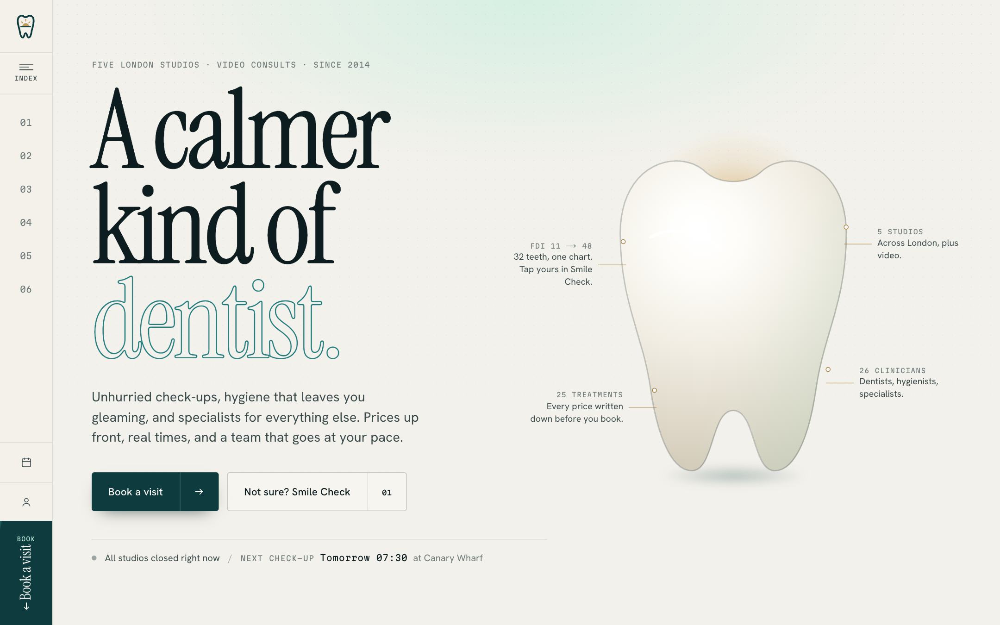

Light and precise: porcelain and enamel surfaces, deep lagoon teal, mint light and brass hairlines, set in Instrument Serif with Hanken Grotesk and Martian Mono for the chart annotations. Set in **London** (GBP, `Europe/London`) with five studios (Marylebone, Shoreditch, Notting Hill, Canary Wharf, Clapham) plus video consultations, and 26 clinicians: dentists, hygienists, paediatric dentists, orthodontists, an implant surgeon and an endodontist. And for children, **Alba Kids**: a cut-paper, risograph-printed picture book called *Pip and the Tooth Town adventure*. MIT licensed: clone it, rebrand it, ship it.

---

## Get Started in 3 Steps

### 1. Create an Opencals account

Sign up at **[app.opencals.com](https://app.opencals.com)** and create a **Dev Store** in the **United Kingdom** (so prices are in GBP). When prompted for a dataset, choose **Alba Dental** (seed dataset `dental_clinic`). It seeds the five studios and the video location with their own opening hours, 26 clinicians with portraits, 25 treatments in eight departments (general, hygiene, cosmetic, orthodontics, implants, emergency, children's dentistry, video), four add-ons (happy air, fluoride varnish, AirFlow polish, digital X-rays), the pre-visit questions (who the visit is for, comfort level, smile concern, a child's nickname), the `NEWSMILE` code and an early-bird hygiene discount, and sample bookings, so your site looks exactly like the demo.

### 2. Get your API key

Go to your **User Account Settings** in the Opencals dashboard and generate a **private storefront key** (`spk_`). The template calls the API from its server, so the key stays secret, and it forwards each visitor's IP (`nextBuyerIp` in `lib/opencals.ts`) so visitors get their own rate limits. A public key (`sfk_`) also works, but then all visitors share your server's limits.

### 3. Deploy to Vercel

[](https://vercel.com/new/clone?repository-url=https%3A%2F%2Fgithub.com%2Fletsopencals%2Ftemplate-alba&env=OPENCALS_API_KEY,AUTH_SECRET&envDescription=API%20key%20from%20your%20Opencals%20dashboard%20and%20a%20random%20secret%20for%20auth&project-name=alba-dental&repository-name=template-alba)

During deployment, Vercel will ask you to set environment variables:

| Variable | Value |
|----------|-------|
| `OPENCALS_API_KEY` | Your private storefront key (starts with `spk_`) |
| `AUTH_SECRET` | Any random string, used for session encryption |
| `NEXT_PUBLIC_STRIPE_PUBLISHABLE_KEY` | *(optional)* Stripe publishable key for card payments |

That's it.

---

## What's Included

### The Home Page

A slim **chart rail** runs down the left edge on desktop (the logo, a numbered index, the cart, your account and a Book tab), and the full menu opens as a typographic index. On phones it becomes a top bar and a bottom dock. The hero is a large **porcelain tooth** whose light follows your pointer, annotated like a dental chart. Below it: **Today at Alba**, a live board with every studio's status and next free check-up and hygiene time; the treatments as a numbered price index; the Smile Check; **the Alba Line**; the team as a contact sheet; patient notes; Alba Kids; and the FAQ.

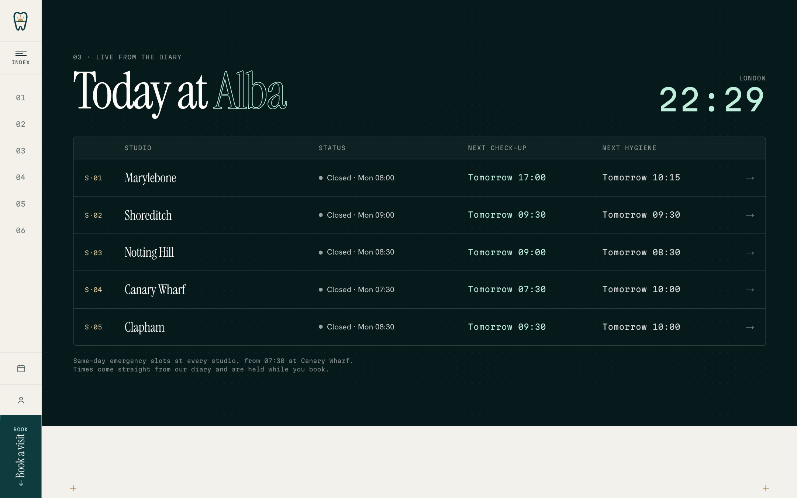

### Smile Check

**`/smile-check`** is a short questionnaire on a real 32-tooth chart (FDI numbering). Tap the teeth on your mind, say what's going on (it hurts, chipped, sensitive, colour, gaps, a missing tooth, or just due a check-up), and set the **comfort dial** from calm to anxious. It suggests the right visit and the studio with the soonest time, and opens the booking with all of it filled in: the comfort level reaches the dentist as a pre-visit answer.

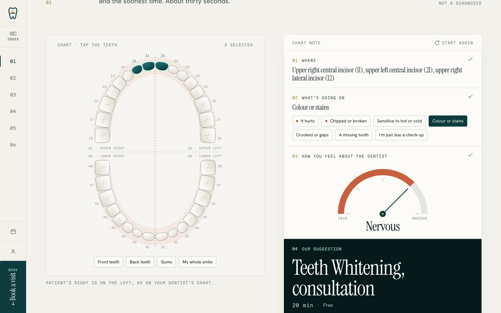

### The Chair Planner

**`/book`** is one screen. The visit is drawn to scale on a **chair-time track**: each treatment is a block as long as its minutes, add-ons hang off it as tabs, and after a check-up **the hygienist straight after** snaps on as a second block (a second visit in the cart, same chair, no second trip). The track is the summary. Around it: the treatment index, the studio on the Alba Line with the next free time at each station and a notice when another studio is sooner, the clinicians as portrait strips with "First available", a strip of days, the times, extras and the patient (who it's for, the comfort dial, the store's questions). **Pencil it in** holds the chair while you finish. On phones the track turns into a vertical column.

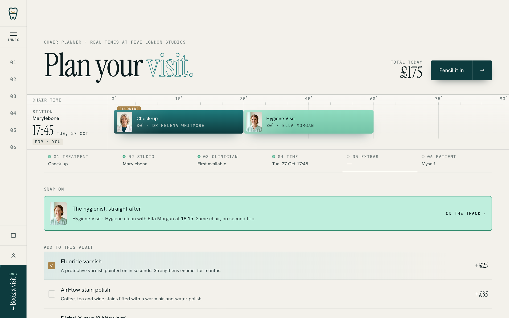

Deep links prefill it: `/book?service=check-up&clinic=marylebone&staff=helena-whitmore&comfort=nervous`, and the children's site uses `for=child&dept=childrens-dentistry&nickname=Maya`.

### Checkout and the Appointment Card

**`/checkout`** is one **patient record**: the visits as small chair-time lanes, your details, the payment (card through Stripe, or pay at the studio), a signature line and the fees, with a code margin down the side. The confirmation is the classic **dental appointment card**, filled in by hand (date, time, clinician, patient) with a tooth-chart strip and the studio's stamp. Turn it over for what to bring and how to get there. Several visits stack as a fan. Underneath, **pencil in your six-month check-up** puts a reminder in your calendar that links straight back.

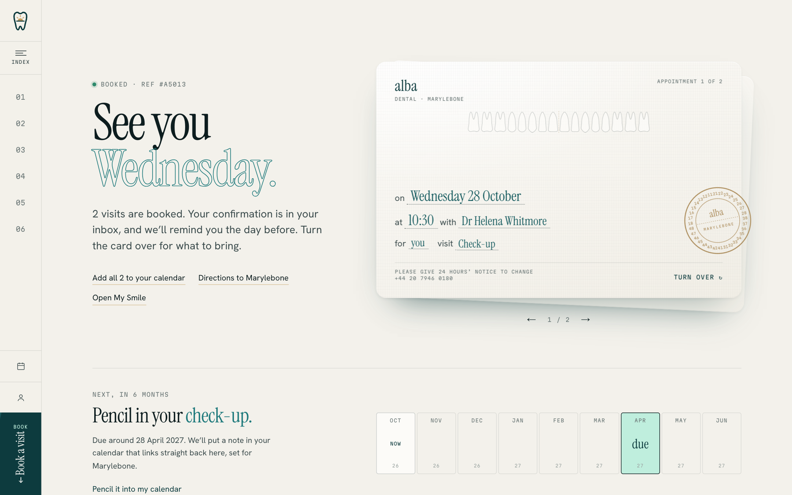

### My Smile

Passwordless sign-in with a 6-digit code or a magic link. **My Smile** shows your **recall ring** (when your next check-up and hygiene visit are due), the next visit as its appointment card, a history timeline with a Today mark, a family switch (visits booked for a child or someone else are grouped by patient), and, for children, the **Tooth Town passport** with a stamp for every visit. Reschedule and cancel up to 24 hours before.

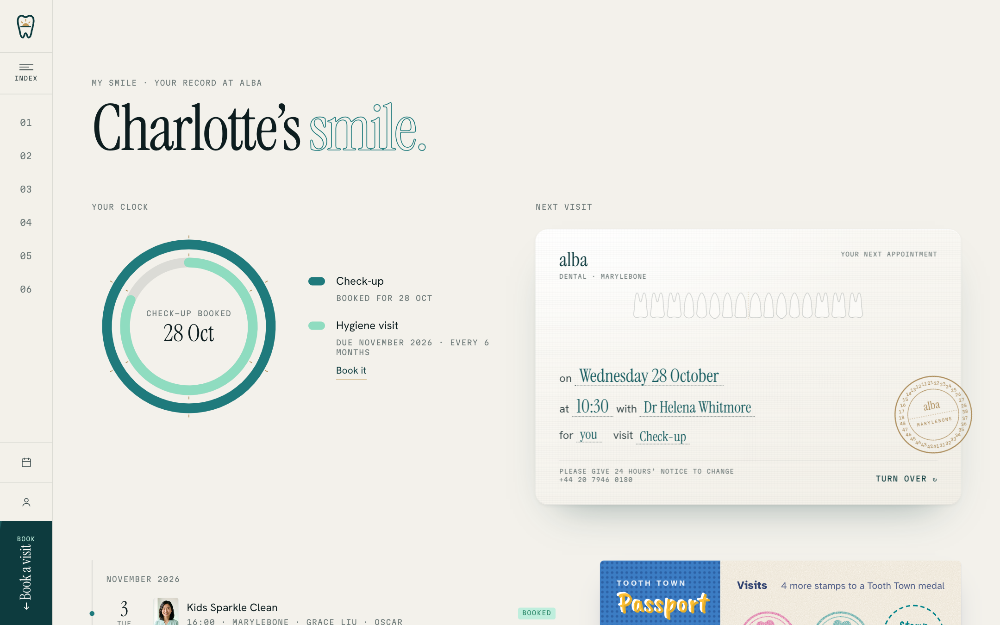

One-time email links from Opencals (view, reschedule or cancel a booking, leave feedback) resolve through `/link/[token]`. Set **Storefront Base URL** in your Opencals dashboard (Settings → API) to your deployed URL so those links point back here.

### Treatments, Studios and Dentists

- **`/treatments`** and **`/treatments/[slug]`**: every treatment in writing, with its length and price, grouped by department.
- **`/clinics`** and **`/clinics/[slug]`**: the five studios on one transit line (kids rooms and the late night marked), each with photography, weekly hours and a "next free chair" board.
- **`/dentists`** and **`/dentists/[slug]`**: all 26 clinicians, filtered by studio, speciality and language.

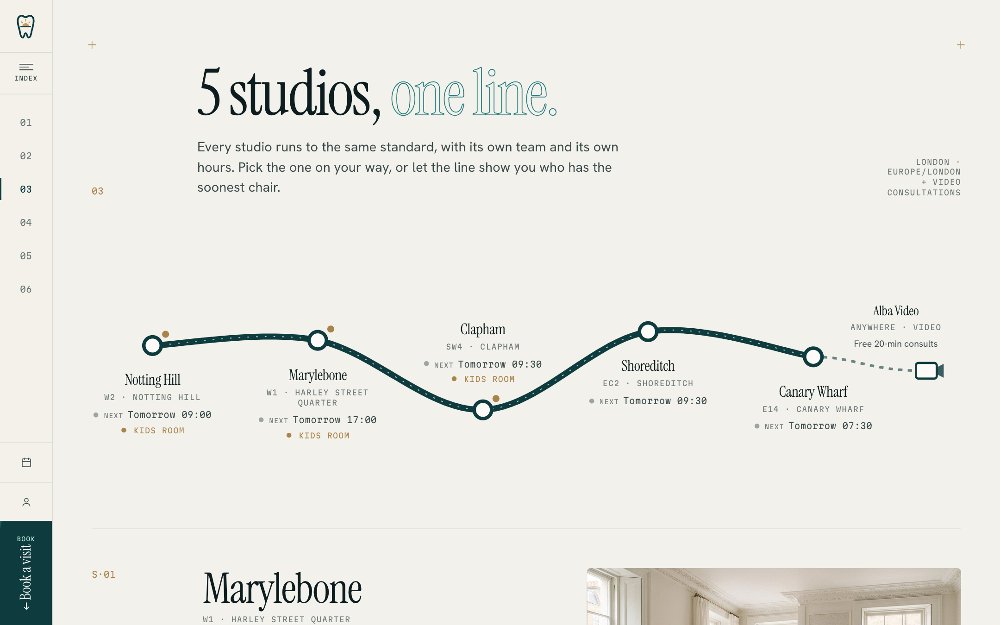

### Alba Kids

**`/kids`** is its own site with its own type (Caveat Brush and Atkinson Hyperlegible), colours and navigation: a picture book in cut paper and four risograph inks, drawn entirely in SVG and CSS. **Pip**, a paper tooth on brass split pins, guides the way.

- **The road through Tooth Town**: every children's service from the store is a stop on a board-game road (Check-up Castle, the Sparkle Wash, Shield Station, the Smile Observatory), with its price, length, age options and studios.
- **Your first visit** as a fold-out leaflet, **Sugar Bug Scrub** (a two-minute brushing game: scrub the bugs off each tooth with a finger, one corner of the mouth every 30 seconds), the **Tooth Heroes** scrapbook, the three kids rooms as pop-up dioramas, and the back pages for grown-ups.
- **`/kids/quest`**: Tooth Quest, a questionnaire for parents written as a story, which ends with the visit to book.
- After a child's visit, a printable **certificate of bravery** on the confirmation, and a stamp in the passport.

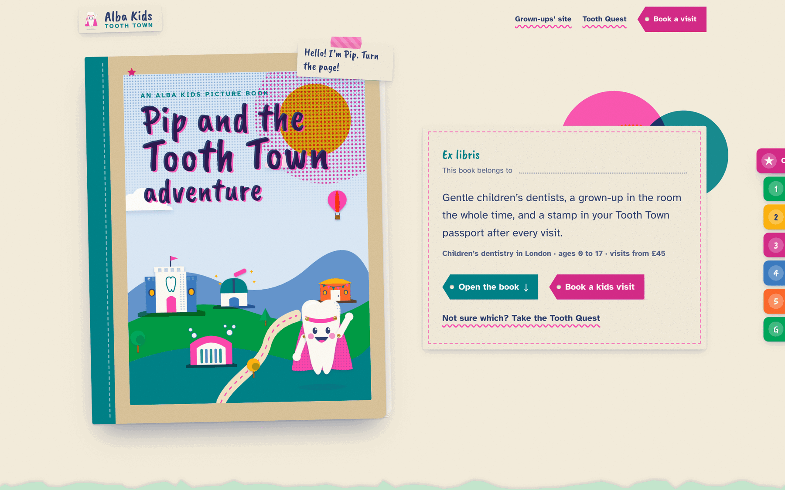

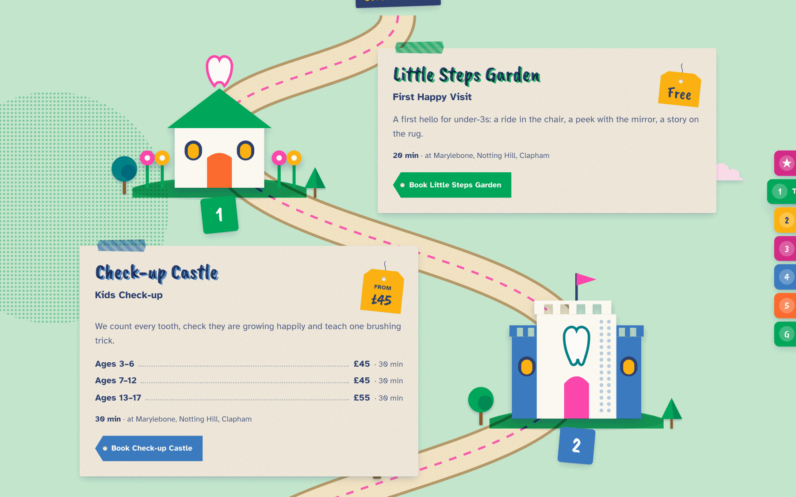

### Motion

Light, not movement: a gleam that sweeps across surfaces as they scroll in, aperture openings for photographs, split-flap times on the board, the pointer-lit tooth, and View Transitions between pages. In Alba Kids, paper pops up as you reach it. Every effect respects `prefers-reduced-motion`.

### SEO Ready

Per-page metadata, Open Graph images, `Dentist` structured data, robots.txt and sitemap.xml, configured out of the box.

---

## Screenshots

| | |
|---|---|
|  | 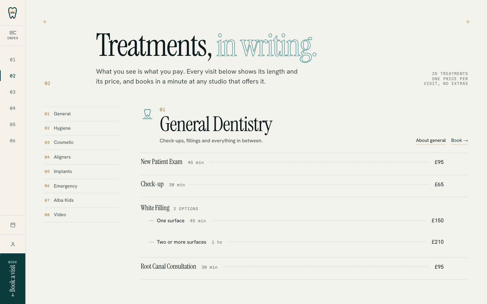 |
|  |  |
| 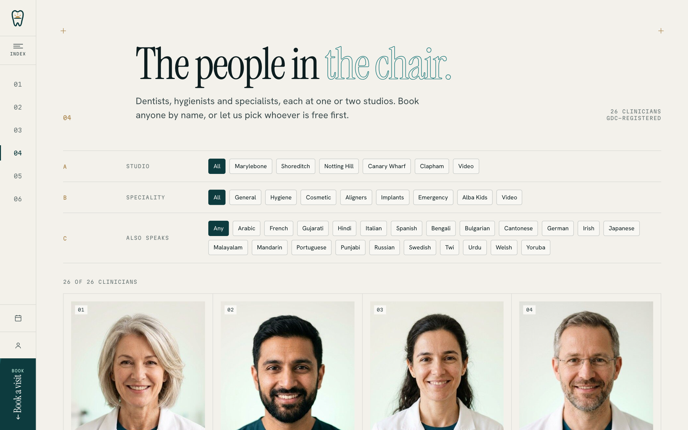 |  |
| 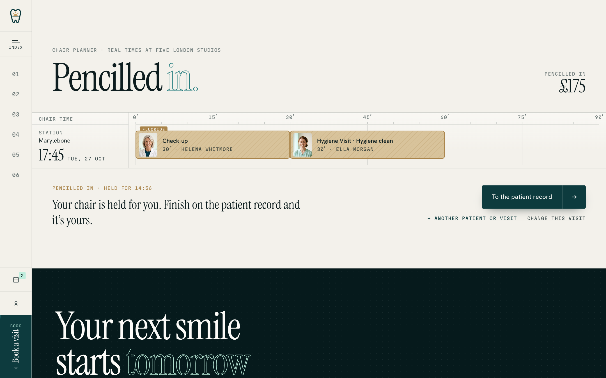 | 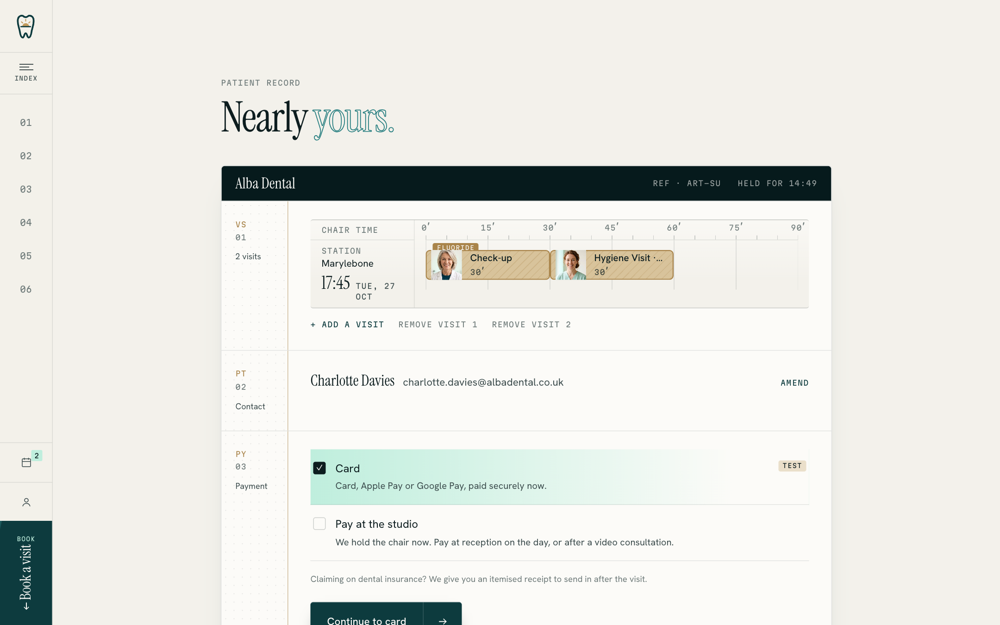 |
|  | 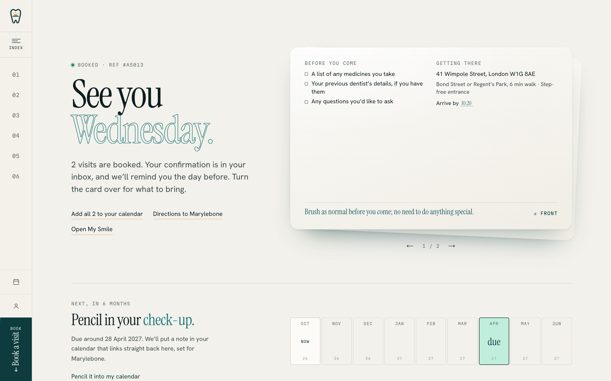 |
|  |  |
|  | 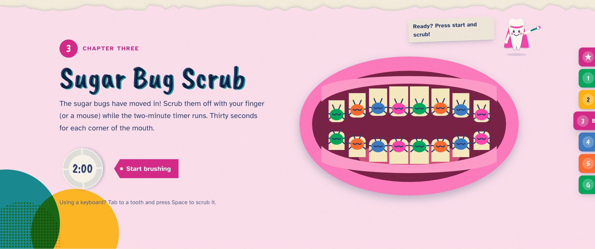 |
| 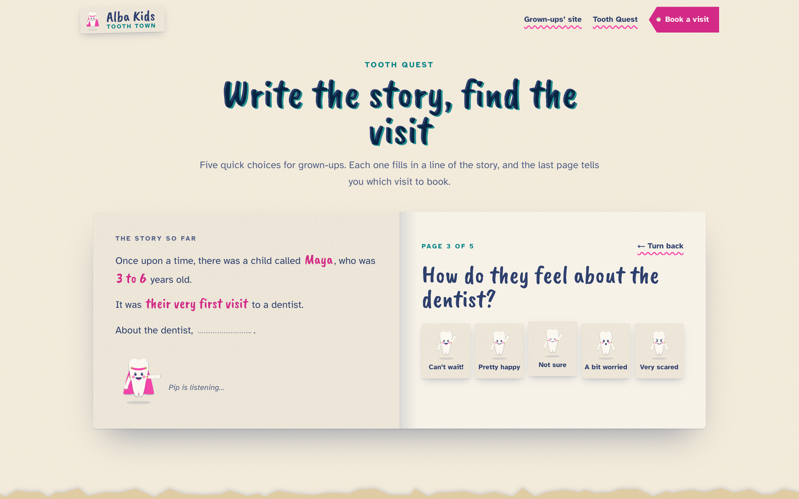 | 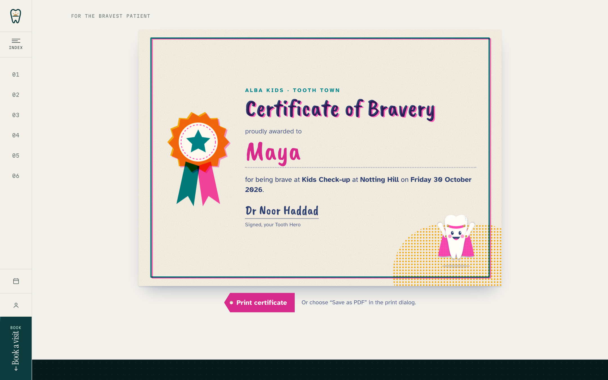 |

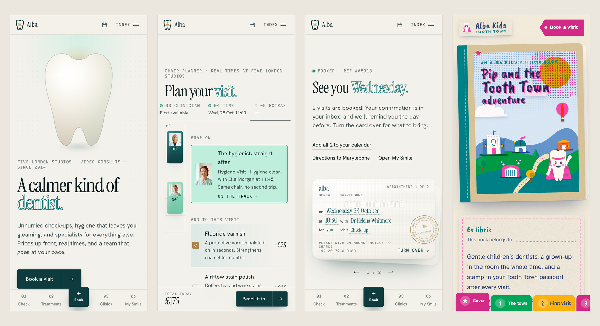

---

## The Data Model

Alba uses existing Opencals features only. If you build your own clinic group, this is the pattern:

- **Studios are store locations**, each with its own opening hours, plus one location of type `online` for video consultations.
- **Departments are collections** (`general-dentistry`, `hygiene`, `cosmetic`, `orthodontics`, `implants`, `emergency`, `childrens-dentistry`, `video-consultations`). `lib/site-config.ts` maps each collection to how it's presented; nothing else is hard-coded.
- **Treatments are product groups; options are variants.** A hygiene visit has three variants (clean, deep clean, AirFlow), a kids check-up has three age bands. Every product books a clinician (one patient at a time) and is offered at the studios where its clinicians work, so a children's service only appears at the studios with a kids room.
- **Clinicians are staff members.** Their studios and treatments come from the API; titles, bios, languages and focus are curated in `site-config.ts` by staff slug.
- **Pre-visit questions are checkout questions**, matched by their `internalName` (`Visit for`, `Patient name`, `Patient DOB`, `Dental last cleaning`, `Comfort level`, `Smile concern`, `Child nickname`) in `lib/intake.ts`. Answers travel with each visit, so a family cart keeps each patient's details apart. A store without them books every visit for "Myself".
- **The hygienist straight after** is a second appointment in the cart, booked at the end of the first.
- **Availability** is read once per studio and treatment for the whole booking window (`/api/availability/studio`, cached 60 s), and the board, day strip, times and "next free" are derived from it.

---

## Tech Stack

| Category | Technology |
|----------|-----------|
| Framework | Next.js 15 (App Router) |
| Styling | Tailwind CSS v4 |
| Fonts | next/font: Instrument Serif, Hanken Grotesk, Martian Mono; Caveat Brush and Atkinson Hyperlegible for Alba Kids |
| Motion | CSS scroll-driven animations, View Transitions |
| Data | SWR (client) + React Server Components |
| Forms | react-hook-form + Zod |
| Payments | Stripe Elements |
| Auth | NextAuth.js v5 |
| Dates | moment-timezone |
| API | Opencals Storefront SDK (v0.3.19) |

---

## Local Development

```bash
git clone https://github.com/letsopencals/template-alba.git
cd template-alba
npm install
cp .env.example .env.local
```

Edit `.env.local`:

```
OPENCALS_API_KEY=spk_your_key_here
AUTH_SECRET=change_me_to_a_random_string
```

```bash
npm run dev
```

Open [http://localhost:3000](http://localhost:3000). The screens behind a finished booking (appointment card, kids certificate, My Smile) can be previewed with fixtures at `/preview/confirmation`, `/preview/confirmation-kids`, `/preview/checkout` and `/preview/account` (in production only with `ALBA_PREVIEW=1`).

---

## Customization

- **`lib/site-config.ts`**: name, contact, studio copy and photography, the collection → department mapping, curated clinician profiles, Smile Check areas and concerns, comfort levels, before-you-come notes and recall intervals.
- **`lib/kids/kids-config.ts`**: Alba Kids copy, the names of the Tooth Town stops, the Tooth Heroes' superpowers and the kids rooms.
- The bookable data (treatments, prices, clinicians, studios, hours, availability, add-ons, questions, discounts) comes from your Opencals store.
- **Theme**: tokens in `app/globals.css` (`@theme`), the design contract in `DESIGN.md`, and Alba Kids in `components/kids/DESIGN-KIDS.md`.

```css
@theme {
  --color-porcelain: #f3f1eb;  /* page */
  --color-enamel: #fcfbf8;     /* cards */
  --color-ink: #0d1d1f;        /* text */
  --color-lagoon: #0d3b3e;     /* the one action colour */
  --color-mint: #bfeedd;       /* light, availability */
  --color-brass: #a9844a;      /* hairlines, stamps */
}
```

---

## Project Structure

```
app/
  (site)/                      # The adult site (chart rail layout)
    page.tsx                   # Home
    smile-check/ treatments/ clinics/ dentists/
    book/                      # The chair planner
    checkout/ thank-you/       # Patient record, appointment card
    account/ auth/ link/[token]/
    preview/[screen]/          # Fixture screens
  (kids)/kids/                 # Alba Kids: Tooth Town and Tooth Quest
  api/                         # API routes proxy SDK calls server-side

components/
  light/                       # Gleam, aperture, split-flap, pointer light, view transitions
  layout/ brand/ ui/           # Chart rail, index menu, dock, primitives
  home/ smile/ book/ checkout/ confirmation/ account/
  kids/                        # The picture book, Pip, Sugar Bug Scrub, certificate, passport

lib/                           # site-config, catalog, intake, slots, studios, teeth, server-data, opencals, auth
```

## Environment Variables

| Variable | Required | Description |
|----------|----------|-------------|
| `OPENCALS_API_KEY` | Yes | Private storefront key (`spk_`) from your Opencals dashboard |
| `AUTH_SECRET` | Yes | Random string for NextAuth session encryption |
| `NEXT_PUBLIC_STRIPE_PUBLISHABLE_KEY` | No | Stripe publishable key for card payments |
| `OPENCALS_API_URL` | No | Override API base URL (defaults to production) |
| `ALBA_PREVIEW` | No | `1` enables the `/preview/*` fixture screens in production |

---

## Other Templates

Alba Dental is one of the open-source booking templates built on the Opencals Storefront SDK. Same backend, different design and vertical:

- **[Clear Care](https://github.com/letsopencals/template-clarity)** — a medical clinic template with department-first booking. [Live demo](https://template-clarity.vercel.app)
- **[Frisor](https://github.com/letsopencals/template-frisor)** — a modern barbershop template with a dark editorial palette. [Live demo](https://template-frisor-sage.vercel.app)
- **[HAAR](https://github.com/letsopencals/template-haar)** — a hair-salon booking template with a light, warm palette. [Live demo](https://template-haar.vercel.app)
- **[VOLT](https://github.com/letsopencals/template-volt)** — a multi-club padel & squash template with a live hall map and court grid. [Live demo](https://template-volt.vercel.app)
- **[NOIR Drive](https://github.com/letsopencals/template-noir)** — a luxury car-rental template (Dubai) with multi-day rentals and chauffeur packages. [Live demo](https://template-noir.vercel.app)
- **[Fluently](https://github.com/letsopencals/template-fluently)** — a language-school template (New York) with group classes, live seats, private lessons and online lessons. [Live demo](https://template-fluently.vercel.app)
- **[Bali Villa Rentals](https://github.com/letsopencals/template-bali-villas)** — a villa-rental template (Bali, demo brand Lumbung Sidemen) with nightly stays and fixed check-in and check-out. [Live demo](https://template-bali-villas.vercel.app)
- **[Tensile](https://github.com/letsopencals/template-reformer)** — a reformer Pilates studio template (Berlin) with a multi-studio class timetable, beds left, privates and workshops. [Live demo](https://template-reformer.vercel.app)

See all templates and the Storefront API at **[opencals.com/developers](https://opencals.com/developers)**.

## Build with AI

Prefer to let an AI agent do the heavy lifting? Install the **[Opencals Agent Skills](https://github.com/letsopencals/skills)** in Claude Code, Cursor, Codex or Gemini CLI:

- **`opencals-build-booking-site`** — scaffold, wire and deploy a template like this one
- **`opencals-storefront-api`** — ground-truth reference for the Opencals API & SDK

Docs: **[opencals.com/docs → AI Agents](https://opencals.com/docs/ai-agents/overview)**.

## License

MIT
